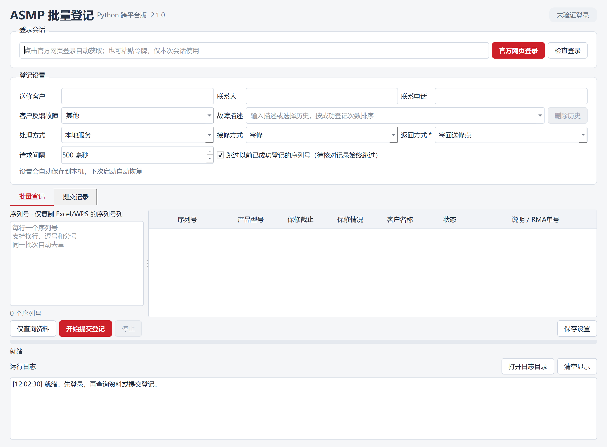

# Hikvision ASMP Tools

**Python desktop application for batch Hikvision ASMP repair registration.**

[中文](README.md) · [Downloads](https://github.com/szrd2026/hikvision-asmp-tools/releases/latest) · [Build status](https://github.com/szrd2026/hikvision-asmp-tools/actions/workflows/build.yml)

Version 2.0 replaces the Windows PowerShell/WinForms application with Python, PySide6, QtWebEngine and SQLite. Windows, Linux and macOS share the same application code. The interface is currently Chinese.

This is an unofficial project, not affiliated with or endorsed by Hikvision. Use an ASMP account you are authorized to operate.



## Features

- Sign in through the official ASMP page in a separate, in-memory browser session. The application reads the session cookie without collecting the account password.
- Query product models and warranty information without creating registrations.
- Paste a serial-number column from Excel/WPS, deduplicate the batch and submit one registration per serial.
- Select return to the collecting point or return to the customer; customer returns require province, city, district and street address. Region choices load from the official API.
- Automatically save business settings after editing and restore them on the next launch, with a visible save status.
- Reuse fault descriptions from an editable dropdown, ranked by successful registrations, and delete unwanted history entries.
- Keep the interface responsive while requests run on a worker thread. Stop prevents subsequent submissions and waits for any request already sent.
- Persist submission intent in SQLite before sending a registration request. Timeouts and malformed responses remain unresolved until checked against the portal.
- Search and export history, reconcile uncertain outcomes, and migrate the original configuration and four-column CSV records.

## Download

Use a platform-specific asset from [Releases](https://github.com/szrd2026/hikvision-asmp-tools/releases/latest), not GitHub's automatically generated source-code downloads. Native packages include the Python runtime.

| Target | Archive suffix | Run |
| --- | --- | --- |
| Windows 10/11 x86_64 | `windows-x86_64.zip` | Extract everything; run `HikvisionASMP.exe` and retain `_internal` |
| Linux x86_64 | `linux-x86_64.tar.gz` | Run `./HikvisionASMP`; build baseline is Ubuntu 22.04 |
| macOS Intel | `macos-x86_64.zip` | Open `HikvisionASMP.app`; macOS 14+ |
| macOS Apple Silicon | `macos-arm64.zip` | Open `HikvisionASMP.app`; macOS 14+ |

Only completed builds are listed as release assets. Packages do not carry a maintainer distribution certificate. A macOS ad-hoc signature is not Developer ID signing or notarization.

## Use

1. Click **官方网页登录** and sign in on `asmp.hikvision.com`.
2. Enter the repair customer, contact and fault settings. Confirm **返回方式**; for **寄回客户**, use **加载省市区** to select the region and enter a full address.
3. Paste only the serial-number column.
4. Use **仅查询资料** for a read-only lookup.
5. Use **开始提交登记** only when ready to create actual registrations.
6. Review the results and **提交记录** history tab.

An uncertain result is always skipped on retry, even when historical-success skipping is disabled. First check the portal's history, then use **核对：已登记** or **核对：未登记** and enter a reconciliation note.

Tokens are kept in memory and are not written to configuration or logs. Business settings, serial history and logs remain in the OS user-data directory. Close the application before backing up that directory.

Settings save after about 0.6 seconds without edits, before tasks and on normal exit. Fault-description usage counts successful devices; query-only, failed, skipped and uncertain attempts do not count. Reconciliation as registered counts once. Ties use most recent success. **删除历史** removes the selected suggestion without changing the active form or submission records; subsequent successful reuse starts its count again. Version 2.0 did not store per-attempt descriptions, so earlier usage cannot be reconstructed.

Upgrading to 2.1 preserves settings and records and defaults the new return setting to the former fixed value, return to the collecting point. The database upgrades to schema 2; back up the data directory before upgrading if you need to return to 2.0.

## Run from source

Python 3.11+ is required; Python 3.13 is used for native builds.

```bash
python3 setup_env.py
bash Start-Submit.sh
```

On Windows, run `python setup_env.py` followed by `Start-Submit.bat`.

## Tests and packaging

```bash
python -m pip install -r requirements-dev.txt
python -m pytest -q
python run.py --smoke-test
python tools/build.py
```

Tests use mocked HTTP requests. Native builds verify the frozen UI and an offline Chromium page. Windows sign-in and real-device read-only lookup have been checked; actual repair registration has not been exercised with production data. CI success does not establish live-portal compatibility on every target.

See the Chinese [installation](docs/installation.md), [migration](docs/migration.md) and [development](docs/development.md) guides. The original Windows implementation is archived under `legacy/powershell/` and excluded from Python packages.

## License

Application code is [MIT licensed](LICENSE). Bundled components retain their own licenses; see [third-party notices](THIRD_PARTY_NOTICES.md). ASMP uses unversioned web endpoints that may change.
