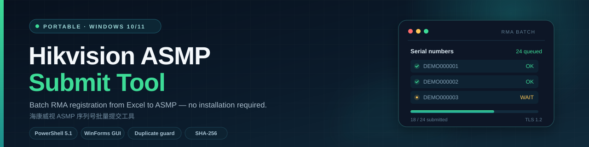
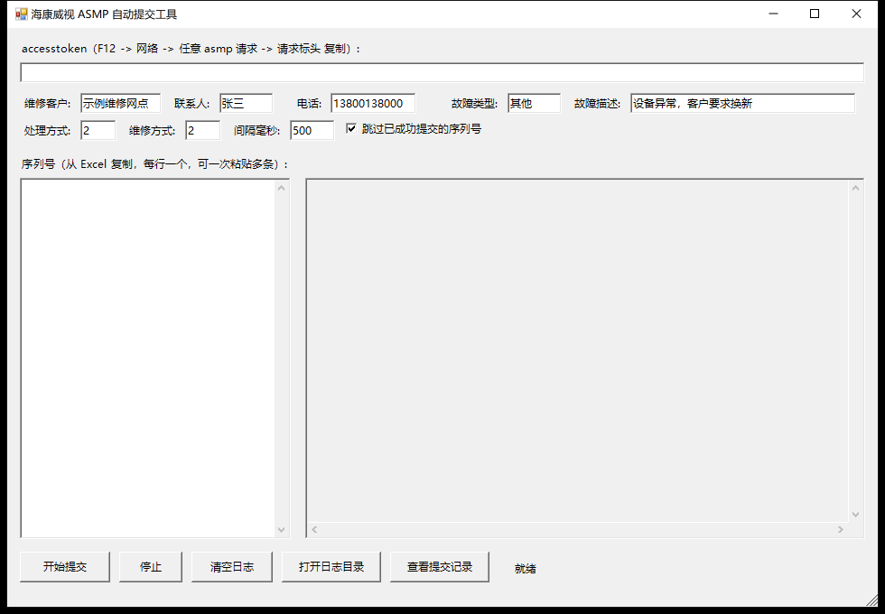

# Hikvision ASMP Submit Tool



**A portable Windows desktop utility for batch RMA registration on Hikvision ASMP.**

[](https://www.microsoft.com/windows)
[](https://learn.microsoft.com/powershell/)
[](LICENSE)
[](https://github.com/szrd2026/hikvision-asmp-tools/releases)

> **Unofficial tool.** This project is not affiliated with, endorsed by, or
> supported by Hikvision. Use it only with an ASMP account you are authorized
> to operate.

---

## Overview

Hikvision ASMP Submit Tool turns a column of serial numbers copied from Excel
into a batch of RMA registrations. For each serial number it looks up the RMA
detail record, assembles the `setNewRma` request with your fixed repair
information, submits it, and writes the result to a local CSV file.

The application is a PowerShell 5.1 + WinForms desktop program. It ships as a
portable ZIP, needs no installation, no administrator rights and no third-party
PowerShell modules.

## Features

- **Bulk input** — paste serial numbers from Excel/WPS, one per line or
  separated by commas or semicolons.
- **Two-step submission** — query `getRmaDetailBySerial`, then submit the
  generated `setNewRma` payload.
- **Configurable repair data** — repair client, contact, phone, fault type,
  fault description, deal type, repair mode and request interval.
- **Duplicate guard** — successful serial numbers are recorded and skipped on
  later runs by default.
- **Live log** — request/response progress is shown in the window and saved to
  `logs\submit_YYYYMMDD_HHMMSS.log`.
- **Local records** — every attempt is appended to `submit_records.csv`.
- **Token masking** — the access token is masked in log output.
- **Portable** — copy the folder anywhere; no registry writes, services or
  installers.
- **TLS 1.2** — outbound HTTPS is restricted to TLS 1.2.

## Screenshot

> The interface below uses the built-in sample values. No real account data is
> shown.



## Requirements

| Item | Requirement |
| --- | --- |
| Operating system | Windows 10 or Windows 11, x64 |
| PowerShell | Windows PowerShell 5.1 (included with Windows) |
| Account | Hikvision ASMP account with RMA submission permission |
| Network | HTTPS access to `asmp.hikvision.com` |
| Privileges | Standard user; administrator rights are not required |

## Quick start

1. Download `Hikvision-ASMP-Submit-v1.0.0-win64.zip` from the
   [Releases](https://github.com/szrd2026/hikvision-asmp-tools/releases) page.
2. Extract the ZIP to a local folder. Do not run the tool from inside the ZIP
   archive.
3. Double-click **`Start-Submit.bat`**.
4. Obtain an `accesstoken` from your browser:
   - Sign in to the Hikvision ASMP web portal.
   - Press `F12` to open Developer Tools.
   - Open **Network**, then trigger any ASMP request.
   - Select the request, open **Request Headers**, and copy the `accesstoken`
     value.
5. Paste the token into the first field.
6. Replace the sample repair client, contact, phone and fault values with your
   own data.
7. Paste the serial numbers into the left-hand box and click **开始提交**
   (Start submission).
8. Review progress in the right-hand log and the results in
   `submit_records.csv`.

> Access tokens are session credentials and expire. If the tool reports
> `notLogin`, sign in again and copy a fresh token.

## Configuration

The application reads `submit_config.json` from its own folder. If the file
does not exist, built-in sample values are used and the file is created when
the window closes. A template is provided as
[`submit_config.example.json`](submit_config.example.json).

| Key | Default (sample) | Description |
| --- | --- | --- |
| `token` | empty | ASMP `accesstoken`; stored locally in plain text |
| `repairClient` | `示例维修网点` | Repair client / service outlet name |
| `linkman` | `张三` | Contact person |
| `linknumber` | `13800138000` | Contact phone number |
| `rebackFault` | `其他` | Fault category expected by ASMP |
| `rebackFaulttext` | `设备异常，客户要求换新` | Fault description |
| `dealType` | `2` | ASMP deal type value |
| `repairMode` | `2` | ASMP repair mode value |
| `delay` | `500` | Delay between requests, in milliseconds |
| `skip` | `true` | Skip serial numbers previously submitted successfully |

### Local data files

| Path | Created when | Contains |
| --- | --- | --- |
| `submit_config.json` | Window closes | Token and fixed repair information |
| `submit_records.csv` | First submission | Time, serial number, model, result |
| `logs\submit_*.log` | Each run | Full request/response log |

These files are excluded by `.gitignore`. **Do not commit or share them.**
Logs and records contain serial numbers and may contain customer or contact
information returned by ASMP.

## Build and package

The project is plain PowerShell and a batch launcher; there is no compiler
step. The release package is produced with `build.ps1`:

```powershell
powershell -NoProfile -ExecutionPolicy Bypass -File .\build.ps1
```

Output:

```text
dist\Hikvision-ASMP-Submit-v1.0.0-win64.zip
dist\checksums.txt
```

The build script stages only the runtime files and documentation, creates the
ZIP and writes its SHA-256 checksum. To verify a download manually:

```powershell
Get-FileHash .\Hikvision-ASMP-Submit-v1.0.0-win64.zip -Algorithm SHA256
```

### Why is there no `.exe`?

The application is a PowerShell script hosted by Windows PowerShell 5.1 and
uses WinForms for its interface. A native executable would require wrapping the
script with a third-party host such as `ps2exe`; the result is still a script
host, is not a true compiled binary, and commonly triggers antivirus and
SmartScreen warnings. The portable ZIP keeps the source readable and
auditable. See [FAQ](#faq) for SmartScreen guidance.

## Security and privacy

- Treat the `accesstoken` as a password. Never paste it into an issue, commit
  it, or share screenshots that contain it.
- The token is stored in `submit_config.json` in plain text. Delete that file
  after use if you do not want it retained.
- Logs and `submit_records.csv` can contain business data. Keep them private.
- The tool talks only to `https://asmp.hikvision.com` over TLS 1.2.
- The tool automates web endpoints used by the ASMP portal. Those endpoints
  are not a public, versioned API and may change without notice.
- You are responsible for complying with Hikvision's terms, your organization's
  policies and applicable law.

## FAQ

### Windows SmartScreen says “Unknown publisher”

The release is not code-signed. This is expected. Verify the SHA-256 checksum
from the release page, then choose **More info → Run anyway**. If Windows marks
the downloaded ZIP as blocked, open its **Properties** and select **Unblock**
before extracting.

### The tool reports `notLogin`

The access token has expired or was copied incorrectly. Sign in to ASMP again,
copy a fresh `accesstoken` from the request headers and retry.

### A serial number fails with “查询明细失败”

The serial number may not exist in ASMP, may not belong to your account, or may
not be eligible for RMA. Check the serial number and its status in the ASMP
portal.

### Will it submit the same serial number twice?

By default, serial numbers recorded as successful in `submit_records.csv` are
skipped. Uncheck the option if you intentionally need to resubmit one.

### Can I run it with PowerShell 7?

Windows PowerShell 5.1 is recommended and is what `Start-Submit.bat` uses.
PowerShell 7 may work but is not the supported runtime for this release.

### Does it need administrator rights?

No. Extract it to a folder the current user can write to, such as Documents or
Desktop.

### Why does the window close immediately?

Run `Start-Submit.bat` from a console to see the error, or run:

```powershell
powershell -NoProfile -ExecutionPolicy Bypass -STA -File .\ASMPSubmitTool.ps1
```

### The API or payload changed

Open an issue with the error message and the relevant (redacted) log excerpt.
Never include a live token or customer data.

## Project structure

```text
.
├── ASMPSubmitTool.ps1          # WinForms application
├── Start-Submit.bat            # Windows launcher
├── submit_config.example.json  # Sanitized configuration template
├── build.ps1                   # Portable ZIP builder
├── docs/                       # Banner and screenshot
├── CHANGELOG.md
├── LICENSE
└── README.md
```

## License

[MIT](LICENSE) © 2026 szrd2026

---

## 中文说明

**海康威视 ASMP 批量提交工具**是一款免安装的 Windows 桌面小工具，用于把
Excel 中的一列序列号批量登记为 ASMP RMA 工单。

### 功能

- 支持从 Excel/WPS 直接粘贴多条序列号，按换行、逗号或分号分隔。
- 自动调用 `getRmaDetailBySerial` 查询明细，再组装并提交 `setNewRma` 报文。
- 可配置维修客户、联系人、电话、故障类型、故障描述、处理方式、维修方式和
  请求间隔。
- 默认跳过 `submit_records.csv` 中已成功提交的序列号，避免重复登记。
- 界面实时显示日志，并按次保存到 `logs\submit_时间戳.log`。
- 每次提交结果追加到 `submit_records.csv`。
- 日志中的 accesstoken 已打码。
- 仅使用 TLS 1.2 访问 `asmp.hikvision.com`。

### 系统要求

- Windows 10 / 11 x64
- Windows PowerShell 5.1（系统自带）
- 具备 ASMP 报修提交权限的账号
- 可访问 `https://asmp.hikvision.com`

### 快速开始

1. 从 [Releases](https://github.com/szrd2026/hikvision-asmp-tools/releases)
   下载 `Hikvision-ASMP-Submit-v1.0.0-win64.zip` 并解压到本地文件夹。
2. 双击 `Start-Submit.bat`。
3. 登录海康 ASMP 网页版，按 `F12` → **网络（Network）** → 任意 ASMP 请求
   → **请求标头（Request Headers）**，复制 `accesstoken` 的值。
4. 把 token 粘贴到程序第一栏，并将示例维修网点、联系人、电话、故障描述替换
   为实际信息。
5. 粘贴序列号，点击「开始提交」。
6. 在右侧日志查看进度，在 `submit_records.csv` 查看结果。

> token 是会话凭证，会过期。提示 `notLogin` 时重新登录并复制新的 token。

### 配置与数据文件

程序读取同目录下的 `submit_config.json`；文件不存在时使用内置示例值，并在
关闭窗口时生成该文件。模板见 `submit_config.example.json`。

| 文件 | 说明 |
| --- | --- |
| `submit_config.json` | token 与固定维修信息，明文保存，已被 `.gitignore` 忽略 |
| `submit_records.csv` | 提交记录：时间、序列号、型号、结果 |
| `logs\submit_*.log` | 每次运行的完整请求/响应日志 |

**这些文件可能包含序列号、客户和联系人信息，请勿提交到 Git 或对外分享。**

### 打包发布

项目是纯 PowerShell + BAT，无需编译。运行：

```powershell
powershell -NoProfile -ExecutionPolicy Bypass -File .\build.ps1
```

生成 `dist\Hikvision-ASMP-Submit-v1.0.0-win64.zip` 和 `checksums.txt`。
未提供 exe：本工具依赖 Windows PowerShell 5.1 与 WinForms，使用 ps2exe 等
工具包装后仍不是原生二进制，且容易触发杀毒软件和 SmartScreen 误报，因此采用
可审计的便携 ZIP。

### 安全提示

- accesstoken 等同于密码，切勿写入 issue、提交到仓库或出现在截图中。
- 工具会把 token 明文保存在本机 `submit_config.json`，使用后可直接删除。
- 日志和提交记录含业务数据，请妥善保管。
- 本工具为非官方项目，与海康威视无隶属关系；请仅使用已获授权的账号，并遵守
  相关服务条款与法律法规。
- ASMP 接口可能随网页版更新而变化，届时需要同步调整程序。

### 常见问题

- **SmartScreen 提示“未知发布者”**：发布包未做代码签名，属正常现象。请先
  核对 Release 页面的 SHA-256，再选择「更多信息 → 仍要运行」。
- **提示 `notLogin`**：token 过期或复制错误，重新登录后复制新的 token。
- **提示查询明细失败**：序列号可能不存在、不属于当前账号或暂不符合 RMA 条件。
- **会不会重复提交**：默认跳过已成功记录的序列号；如需重提可取消勾选。
- **需要管理员权限吗**：不需要，解压到当前用户可写目录即可。

### 许可

[MIT](LICENSE) © 2026 szrd2026
