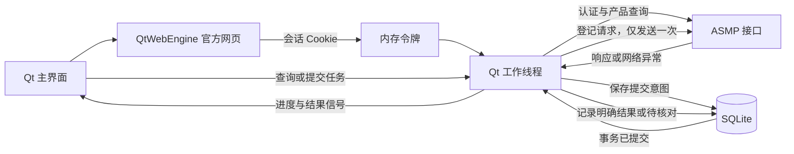

# Python 2.0 架构与提交状态

## 重构范围

2.0 重写界面、网页登录、HTTP、配置、批量任务和提交记录。原设置范围、网页固定字段及每个序列号一份登记的行为保持不变。旧 Windows 实现归档在 `legacy/powershell/`，新运行包不依赖它。

## 数据流

官网页面处理账号和密码；宿主只读取适用于业务接口的 `asmp_sr_token` Cookie。登录 profile 不具备持久存储名称，使用内存缓存和无持久 Cookie。页面顶层导航限于 ASMP 官方 HTTPS 域名，客户端请求限于已知接口路径，不跟随凭据请求的重定向。

## 请求结果分类

只有 HTTP 2xx 且业务 `code="000"` 才算成功。业务码 `003`、`013` 和 HTTP 401/403 表示认证失效；有效业务拒绝与传输/协议异常分开处理。提交中的网络错误、空响应、HTML 或 HTTP 异常都不能证明后台没有创建工单。

报文由 `models.py` 根据查询资料及原有设置生成。服务端返回的型号、保修、客户、物料、附件和质检字段被保留。提交前验证 SR02 权限、网点能力、必填字段及一年包换条件。

## 持久提交状态

SQLite 使用 WAL 和 FULL synchronous。`reserve()` 在 `BEGIN IMMEDIATE` 事务内重新检查重复记录并写入 pending，事务提交完成后才发送登记。终态更新独立提交；进程中断或结果写入失败后，先前意图依然保留。

| 当前状态 | 事件 | 后续状态 |
| --- | --- | --- |
| 无待核对记录 | 事务保存意图 | `pending` |
| `pending` | 收到明确成功 | `succeeded` |
| `pending` | 收到明确业务拒绝 | `rejected` |
| `pending` | 收到认证失效 | `auth` |
| `pending` | 响应不明确 | `unknown` |
| `pending` / `unknown` | 人工确认已登记 | `succeeded`，保留核对事件 |
| `pending` / `unknown` | 人工确认未登记 | `rejected`，保留核对事件 |

待核对优先于历史成功，且不受历史跳过开关影响。每次尝试独立保存，后一次失败不会抹去以前的成功。记录为终态后，不允许通过核对入口随意改写。

## 停止和线程

网络及业务操作运行在工作线程；主线程只更新界面。停止通过线程安全事件传递，在查询后和保存意图后检查，避免再开始新提交。已发出的登记请求不强制取消，因为取消客户端等待无法确定后台是否已提交。

运行期间关闭窗口会请求停止，等待工作线程结束。意外终止仍由数据库中的 pending 记录保护。

## 配置与迁移

配置使用 UTF-8、同目录临时文件、fsync 和原子替换。旧 token 只进入本次内存会话，不写入新配置。

旧 CSV 以意图/结果行配对迁移，记录来源及已迁移行摘要，仅允许增量追加。表头、截断行、未知状态或已导入内容改写都会停止并回滚迁移。早期 1.x 把超时也记作失败，缺少明确拒绝依据的失败按 unknown 保留；早期导入器留下的同类状态也会修正。

## 验证与边界

回归测试覆盖核心规则、存储故障、并发保护、迁移和真实 Qt 工作线程驱动的模拟业务。原生包在目标系统检查主窗口及离线 Chromium。Windows 真实登录和设备只读查询已验证，生产维修登记尚未做实单验证。

CI 负责目标系统构建与离线检查，当前结果见 [Actions](https://github.com/szrd2026/hikvision-asmp-tools/actions/workflows/build.yml)。它不验证用户账号权限或真实后台提交。构建、签名及发行版条件见 [开发文档](development.md)。
